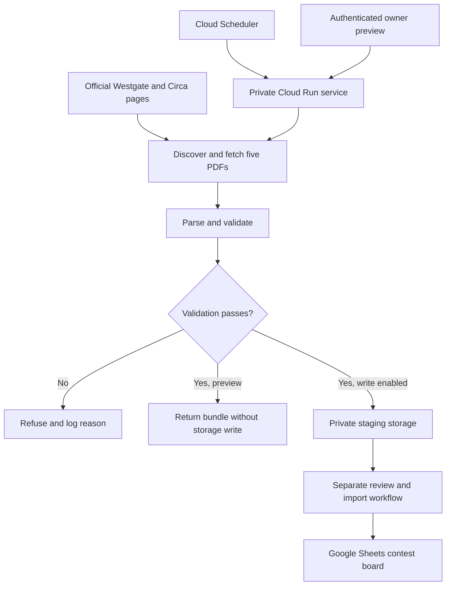

# Cyrus Consolidation Analyzer

### Multi-Source Data & Decision Workflow Engine

**Project owner:** Robert Legorreta  
**Status:** Private pilot — deployed staging service; end-to-end weekly acceptance still open  
**Engineering checkpoint:** October 27, 2026

> Turn scattered source documents into consistent, validated information that people can review and act on. Collect the inputs, reconcile their differences, surface agreement, and deliver a traceable view—without silently filling gaps with assumptions.

**The product story is business automation. The sports-document workflow is the first pilot, not the limit of the design.** This project is not a predictive model or a wagering platform.

## The business problem

Many organizations spend hours gathering information from separate sources, checking whether it belongs to the same reporting period, comparing overlapping records, and preparing a usable dashboard. The work repeats, but the inputs rarely arrive in a perfectly consistent format.

The Cyrus Consolidation Analyzer explores a reusable solution pattern:

**Collect → Standardize → Validate → Consolidate → Compare → Review → Deliver**

The goal is not merely to copy several files into one place. It is to create a controlled information workflow that can explain where its data came from, how it was checked, where sources agree, and why processing stopped when a requirement was not met.

That pattern can support reporting, exception review, operational coordination, and human decision-making. It does not require forecasting an outcome.

## First pilot: weekly contest documents

I chose this first use case because I knew the domain well enough to recognize incorrect inputs, inconsistent comparisons, and misleading outputs. That familiarity provided a practical starting point for building and testing the workflow. It does not define the range of customers or industries this work is intended to serve.

**The founding focus is automation across business workflows—not a company limited to gambling-related tools.** The pilot is disclosed here for transparency, while the reusable engineering principles and potential customer applications lead the project story.

Weekly contest analysis starts with a surprisingly demanding data problem: finding the right documents, matching their season and week, identifying the leading entries, preserving ties, and reconciling selections and lines across two different contests.

A manual workflow makes it easy to use an outdated file, miss a tied entry, or combine documents from different weeks. My goal is to make the intake repeatable, auditable, and explicit about what it can—and cannot—verify.

The guiding rule is simple:

**Missing or inconsistent source data must stop the workflow rather than silently produce a misleading report.**

This README documents both the implementation and the troubleshooting. Passing unit tests and deploying a service are important milestones, but they are not the same as proving that the entire weekly workflow succeeds unattended.

## What the current implementation does

- Discovers official Westgate and Circa document links.
- Retrieves five required PDFs for a specific season and week.
- Extracts standings, selected entries, picks, and contest lines.
- Includes complete tie groups when selecting the top three standings positions.
- Validates the combined data before attempting a staging write.
- Produces a deterministic content hash for the staged data.
- Uses private cloud storage with create-only object handling.
- Provides an authenticated, no-write preview endpoint.
- Supports scheduled weekly intake through Cloud Scheduler and Cloud Run.
- Logs validation refusals so operational failures have actionable explanations.

The broader workflow uses Google Sheets and Apps Script for owner review and controlled import. **The intake service itself does not directly update Google Sheets.** A successful staging operation must not be presented as a successful Sheet import.

### From consolidation to a useful view

The broader board workflow compares selections across qualifying entries and displays agreement counts, with the two source groups kept distinguishable. In this pilot, consensus means observed agreement among selected entries—not a forecast probability, proof of independence, or a recommendation to act.

The same display principle can be adapted to other domains: keep the underlying sources identifiable, show the comparison explicitly, and make exceptions visible. The definition of agreement must be specified for each customer. For example, matching vendor specifications is different from counting independent approvals or reconciling transaction amounts.

The intake service stages validated data; the board performs downstream presentation. These capabilities should not be confused with a single generic consensus API, which has not been demonstrated.

## Where the design can be applied

The following are **potential customer adaptations**, not implemented integrations or validated production deployments. Each would need its own source connectors, rules, access controls, and acceptance tests.

| Customer need | Example inputs | Adapted workflow and display | New work required |
| --- | --- | --- | --- |
| Supplier and procurement comparison | Quotes, product specifications, delivery commitments | Normalize comparable fields, flag conflicting terms, and present a side-by-side review | Quote parsers, currency/unit normalization, supplier identifiers, and approval rules |
| Operations reporting | Team exports, service queues, weekly status files | Consolidate reporting periods, identify missing submissions, and display status and exceptions | System connectors, status mapping, deduplication, ownership and access rules |
| Invoice and purchase-order review | Invoices, purchase orders, receiving records | Compare amounts and quantities, flag mismatches, and prepare a review queue | Document extraction, accounting rules, permissions, and human approval; no automatic payment assumed |
| Inventory reconciliation | Warehouse counts, supplier feeds, inventory exports | Compare item records and surface discrepancies or stale inputs | SKU mapping, unit conversion, freshness thresholds, and inventory-system integration |
| Customer feedback analysis | Surveys, support exports, product feedback | Group related issues and show recurring themes with links to evidence | Privacy controls, text classification, quality evaluation, and careful treatment of duplicate feedback |
| Compliance evidence tracking | Checklists, inspection records, policy acknowledgments | Assemble required evidence, flag missing or expired records, and present review status | Retention policies, role-based access, domain rules, and qualified review; no compliance certification implied |
| Management reporting | Approved departmental reports and business-system extracts | Standardize a reporting cycle and assemble a traceable executive summary | Business metrics, reconciliation rules, authorized integrations, and report design |

### More than a consolidation tool

With customer-specific development, the architecture can support several workflow roles:

- **An exception-review workflow:** stop or route incomplete records instead of letting them pass unnoticed.
- **An evidence collection workflow:** gather supporting documents and preserve their relationship to a report.
- **A reconciliation assistant:** compare records against explicit rules and explain discrepancies.
- **A reporting coordinator:** collect period-specific inputs and prepare validated material for a dashboard.
- **A human approval workflow:** separate prepared data from authorized downstream action.

These are extensions of the design pattern, not claims that a universal automation product already exists. Email alerts, ticket creation, CRM updates, accounting actions, and other outbound integrations would require additional implementation and authorization.

## What is reusable—and what is specialized

| Reusable design principle | Current pilot implementation | Customer-specific adaptation |
| --- | --- | --- |
| Source discovery and collection | Official web pages and PDF links | Authorized APIs, file exports, or document repositories |
| Period alignment | Season/week and prior-period standings | Reporting month, billing cycle, batch, or effective date |
| Structured extraction | Contest-specific PDF parsing | Domain-specific fields and schema |
| Validation before persistence | Source completeness, tie handling, picks and lines | Required fields, ranges, uniqueness, reconciliation, and approval rules |
| Traceable staging | Raw documents and content-addressed bundles | Evidence retention and versioned records appropriate to the customer |
| Explicit agreement and differences | Selection agreement in the downstream board | Defined comparison metrics, discrepancy categories, or approval counts |
| Controlled delivery | Private staging and separate Sheet import | Authorized dashboard, business system, or review queue |
| Operational diagnosis | Route-specific refusal logging | Run identifiers, alerts, ownership, and recovery procedures |

The existing code is **not yet a plug-and-play connector framework**. Its discovery and parser modules contain pilot-specific assumptions. The reusable asset is the architecture and workflow discipline, with a path to extracting common interfaces as additional use cases are built.

## Customer engagement approach

A practical adaptation would begin with a narrow, measurable workflow:

1. Identify the manual task, users, and desired output.
2. Establish permission to access each input and retain the necessary evidence.
3. Define the common schema, reporting period, comparison rules, and refusal conditions.
4. Build and test source-specific adapters against representative documents.
5. Run in preview mode and compare the output with a verified manual baseline.
6. Add approved delivery or write actions only after acceptance.
7. Monitor missing inputs, exceptions, timing, and changes to source formats.

Potential measures include manual preparation time, reconciliation accuracy, missing-input detection, correction frequency, and delivery timeliness. **Customer time savings, return on investment, and accuracy improvements have not yet been quantified for this project.**

## Scope and boundaries

This repository presents the **Cyrus Consolidation Analyzer** through its current **Cyrus Contest Board intake pilot**. It is separate from the touchdown and average passing yards modeling work and from the Fantasy Football Draft Analyzer. Existing source filenames and service names may retain the pilot's earlier terminology.

It does not currently establish:

- A predictive advantage or validated forecast accuracy.
- A fully autonomous, production-certified reporting system.
- Guaranteed source publication times.
- Reliable historical retrieval from a rolling source page.
- Completion of the Week 8 staging-to-Sheet workflow.

## Current pilot architecture



The storage and downstream import branches are intentionally distinct. Validation, persistence, and reporting have different failure modes and need separate verification.

### Main components

| Component | Responsibility |
| --- | --- |
| `app.py` | Flask routes, input validation, schedule configuration, orchestration, and error reporting |
| `cyrus_intake/discovery.py` | Official-page parsing, link discovery, redirect handling, and source retrieval |
| `cyrus_intake/parser.py` | PDF extraction, contest-data validation, and bundle construction |
| `cyrus_intake/schedule.py` | Mapping a local calendar date to a supported contest week |
| `cyrus_intake/storage.py` | Private staging persistence |
| `tests/test_discovery.py` | Source matching and discovery safeguards |
| `tests/test_parser.py` | Verified fixture expectations and malformed-source refusals |
| `tests/test_schedule.py` | Week calculations and supported-week boundaries |
| `tests/test_service.py` | Route behavior, preview defaults, and configuration refusals |

### Technology stack at this checkpoint

| Layer | Implementation |
| --- | --- |
| Runtime | Python 3.12 |
| HTTP service | Flask 3.1.2 |
| Application server | Gunicorn 23.0.0 |
| PDF extraction | pypdf 6.1.1 |
| Storage client | google-cloud-storage 3.4.1 |
| Packaging | Docker, using a Python 3.12 slim base |
| Hosting | Google Cloud Run |
| Scheduling | Google Cloud Scheduler |
| Staging | Private Google Cloud Storage |
| Downstream board | Google Sheets and Apps Script; formula-free workflow |

These are the versions observed in the deployment requirements at this checkpoint, not a claim that they are the newest releases. Direct dependencies are pinned; the container base and transitive dependency reproducibility remain separate hardening considerations.

## Source contract: five documents, one consistent week

For target week **N**, the pipeline requires:

| Source | Required period | Purpose |
| --- | --- | --- |
| Westgate game card | Week N | Contest teams and lines |
| Westgate selections | Week N | Current-week entry selections |
| Westgate standings | Week N−1 | Rankings entering the target week |
| Circa selections | Week N | Current-week entry selections |
| Circa standings | Week N−1 | Rankings entering the target week |

For example, Week 8 needs Week 8 selections and the Westgate Week 8 card, paired with Week 7 standings. Week 7 standings cannot substitute for the Week 6 standings needed to reconstruct the pre-Week 7 leader pool.

The documented validation contract includes:

- Exactly the five expected source categories.
- Unambiguous source matches rather than silently selecting among duplicates.
- Current-week cards and selections paired with prior-week standings.
- Whole standings tie groups through the top three positions.
- Exactly five distinct picks per selected entry.
- A 14-matchup / 28-unique-team expectation in the current implementation.
- Matching Westgate and Circa team pools.
- Consistent Circa number/team/line mapping and opposite lines within matchups.
- Approved final source hosts for downloaded PDFs.

**Important limitation:** the current 14-game expectation is not evidence of support for every NFL slate size. Weeks with a different valid game count need explicit handling and tests before being considered supported end-to-end.

An entry is not necessarily a unique person. Any board or analysis should retain that distinction.

## Service interface

| Route | Behavior |
| --- | --- |
| `GET /health` | Returns service health and staging-only mode; does not prove source readiness |
| `GET` or `POST /run?season=YYYY&week=N&write=false` | Explicit-week preview; no staging write |
| `GET` or `POST /run?season=YYYY&week=N&write=true` | Explicit-week staging request after validation |
| `POST /scheduled` | Computes the week from configured local time and requests staging |

`/run` defaults to preview when `write` is omitted. `/scheduled` is write-enabled for supported weeks; it should not be used as a harmless health check.

Supported scheduled week numbers are 2–18. Dates outside that range return a no-write skip. A valid week number alone does not prove that its documents or slate satisfy all parser constraints.

Required configuration includes `SCHEDULE_SEASON`, `SCHEDULE_WEEK1_DATE`, `SCHEDULE_TIMEZONE`, and `STAGING_BUCKET` when writing. Real resource names and account identifiers are intentionally omitted from this public-facing documentation.

## Engineering case study: what went wrong—and what changed

### 1. The configured schedule did not match the intended workflow

**Observed:** Cloud Scheduler was configured for Sunday at 10:30 a.m. Central, rather than the intended Saturday intake window.

**Change:** The job was updated to Saturday at 8:00 p.m. in `America/Chicago`, using cron `0 20 * * 6`. This positions intake before the intended approximately 9:00 p.m. downstream reporting window.

**Verification:** The job was enabled and showed the next Saturday execution time.

**Boundary:** Correcting the schedule does not explain the exact validation refusal during the original Week 7 attempt. Source availability, execution duration, and retries can also push completion beyond the desired reporting time.

### 2. Moving execution to Saturday exposed a week-boundary mismatch

**Observed:** The week calculator uses elapsed seven-day intervals from a configured Week 1 date. A Sunday anchor would map the preceding Saturday to the prior week.

**Change:** The operational anchor was changed from September 13 to September 12, 2026, to align the configured calculation with Saturday intake. This is a workflow anchor, not a claim about the NFL season's opening game date.

**Verification:** Explicit checks passed for October 24 → Week 7, October 31 → Week 8, and November 7 → Week 9.

**Lesson:** Changing a cron schedule can change business behavior even when the application code is untouched.

### 3. Validation refusals were visible to callers but not sufficiently explained in application logs

**Observed:** The application returned HTTP 422 and a refusal reason, but caught intake-validation exceptions did not emit a corresponding warning. Historical request failures were therefore much harder to diagnose.

**Change:** Warning logs were added to both `/run` and `/scheduled`, recording the route and refusal reason while preserving the existing response behavior.

**Verification:** Existing service tests passed. After deployment, a live no-write Week 8 request returned a missing-card refusal, and the same reason appeared in Cloud Logging.

**Boundary:** New logging improves future diagnosis; it cannot recover information that was not captured during the original failure.

### 4. A later Week 7 rerun could not find prior-week Circa standings

**Observed:** On October 27, an explicit Week 7 preview failed with `expected one Circa Week 6 standings post; found 0`. The parsed Circa page contained Week 7 selections and Week 7 standings.

**Action:** The refusal was preserved. The workflow was not changed to accept the wrong standings week.

**Unresolved:** This explains the later rerun failure, not necessarily the original Sunday failure. The page contents at the time of that original attempt were not established. A reliable historical-discovery fallback has not been demonstrated.

**Lesson:** A rolling landing page is a fragile dependency for replaying historical workflows.

### 5. The full test suite initially failed before parser tests could run

**Observed:** Parser test setup referenced PDFs under a fixture path that did not exist in Cloud Shell. This was a missing-fixture error, not demonstrated parser failure.

**Change:** Five archived Week 6 raw PDFs were retrieved from private staging storage. Their SHA-256 hashes were checked against the hashes encoded in their filenames. The test runner mapped those files into the parser tests in memory.

**Verification:** All 25 tests passed with the recovered fixtures.

**Boundary:** The temporary fixture mapping did not permanently fix the repository's test-fixture configuration. A clean checkout still needs a documented, portable fixture setup.

### 6. The first local test environment did not match deployment dependencies

**Observed:** Cloud Shell had pypdf 6.21.3 installed, while deployment pinned pypdf 6.1.1.

**Change:** An isolated Python environment was created and populated from the deployment requirements.

**Verification:** All 25 tests passed again, using the pinned direct dependencies. The final observed run completed in approximately 57 seconds.

**Lesson:** A local pass is stronger evidence when the tested dependency versions match the deployed application.

### 7. Week 8 preview stopped at a missing Westgate card

**Observed:** The deployed service returned HTTP 422: `expected one westgate_card for 2026 week 8; found 0`. Inspection of parsed Westgate rows showed cards for Weeks 1–7, but no Week 8 card.

**Action:** No matching rules were loosened. The preview remained no-write.

**Boundary:** This supports the missing-listing explanation for that request. It does not prove that all other Week 8 sources are ready, nor that the source could not exist elsewhere.

## Verified results as of October 27, 2026

| Check | Result | What it does not prove |
| --- | --- | --- |
| Full suite with archived fixtures and pinned direct dependencies | 25 tests passed | Every future document layout or slate is supported |
| Saturday week-mapping checks | Three target dates passed | All date and timezone edge cases are covered |
| Updated source deployment | Completed; new revision serving all traffic | Full weekly business workflow succeeded |
| Authenticated health request | `ok: true`, staging-only mode | Sources are complete or storage writes will succeed |
| Week 8 no-write preview | Refused on missing Westgate Week 8 card | Remaining Week 8 sources are valid |
| Live refusal log | Exact route and reason captured | Historical failure reasons can be reconstructed |

The PDF parser emitted structural warnings during some fixture tests, but the tests completed successfully. Those warnings should be documented and investigated as appropriate—not confused with failed assertions or treated as proof that every source PDF is well formed.

## What worked well

- **Refusal rather than substitution:** absent sources did not result in a misleading mixed-week preview.
- **Historical test evidence:** archived PDFs allowed validation against an established Week 6 dataset.
- **Preserved ties:** leader selection does not arbitrarily drop entries tied at the cutoff.
- **Separated responsibilities:** intake, staging, and Sheet import can be examined independently.
- **Explicit preview mode:** discovery and parsing can be exercised without creating staging objects.
- **Recoverable changes:** the logging patch was backed up and tested before deployment.
- **Evidence-based troubleshooting:** screenshots, responses, configuration, and logs were used to distinguish observed facts from hypotheses.

## What needs improvement

- **Historical source discovery:** rolling pages can remove documents needed for reruns.
- **Portable fixtures:** the default test setup still depends on a location-specific fixture path.
- **Regression coverage:** Saturday mapping was checked separately; dedicated committed regression tests and explicit logging assertions should be added.
- **Slate-size handling:** fixed matchup expectations need review against supported weeks.
- **Operational observability:** refusal logs now exist, but durable success summaries, run correlation, and missing-run alerts would improve supportability.
- **Timing guarantees:** retries and approximate downstream trigger timing need to be considered together.
- **Public reproducibility:** a clone-and-run experience needs sanitized configuration, fixture instructions, and independently verified setup steps.
- **End-to-end acceptance:** staging success and successful controlled Sheet import still require separate evidence for Week 8.

## Development and testing notes

Once the source code is included in the repository, a local environment can be prepared with:

```bash
python3 -m venv .venv
source .venv/bin/activate
python -m pip install -r requirements.txt
```

The ordinary test discovery command is:

```bash
python -m unittest discover -s tests -v
```

**Fixture prerequisite:** this command will not reproduce the reported full pass on a clean checkout until the five expected PDFs are available at the configured test paths or the test configuration is made portable. The reported pass used an in-memory fixture override. No public fixture download or automated fixture installer is claimed here.

Do not commit a local virtual environment, authentication files, private PDFs, account-specific configuration, or unredacted logs. Deployment instructions should be added only after the public source package and required permissions have been reviewed.

## Roadmap and acceptance gates

- [x] Identify and correct the Saturday scheduling mismatch.
- [x] Align the week anchor with Saturday intake and check target dates.
- [x] Add and deploy refusal logging.
- [x] Recover archived fixtures and verify their hashes.
- [x] Pass the 25-test suite with deployment-pinned direct dependencies.
- [x] Verify live health and a logged no-write refusal.
- [ ] Make fixture configuration portable and document a reproducible test setup.
- [ ] Commit dedicated Saturday-boundary and refusal-logging regression tests.
- [ ] Review slate-size assumptions and add appropriate coverage.
- [ ] Design and test historical-source discovery without wrong-week substitution.
- [ ] Run a successful Week 8 preview once all required sources are available.
- [ ] Verify scheduled staging execution and stored Week 8 artifacts.
- [ ] Verify controlled import and correct Week 8 display in the owner Sheet.
- [ ] Add missing-run alerts and an operator recovery procedure.
- [ ] Complete security, data-rights, and repository-publication review.

The end-to-end acceptance gate is not simply “HTTP 200.” It requires correct season/week data, validated source alignment, successful staging, and a separately verified downstream import without damaging historical board or ledger data.

## Security, data rights, and publication

The service is intended to remain private and authenticated. The public repository should describe the design without exposing live access details.

Before publishing code or supporting files:

1. Remove tokens, service-account keys, credentials, and local authentication artifacts.
2. Replace real project, bucket, Sheet, and Apps Script identifiers with placeholders.
3. Review screenshots and logs for email addresses, private URLs, account identifiers, and unnecessary entry-level data.
4. Confirm redistribution rights before including third-party source PDFs or extracted datasets. Public accessibility does not by itself establish redistribution permission.
5. Keep private operational backups and historical ledgers out of the repository.
6. Choose a source-code license explicitly; do not imply third-party data is covered by that license.

This documentation does not grant a license to Westgate or Circa materials and does not imply affiliation or endorsement.

## AI-assisted engineering and ownership

I used AI assistance to review code, develop diagnostic steps, interpret test results, and document the repair process. I executed the Cloud Shell commands and supplied observed outputs for verification.

This was not an autonomous AI deployment. Human review, controlled execution, test evidence, and clear separation between confirmed results and assumptions remained part of the process.

## Portfolio positioning

**Cyrus Consolidation Analyzer demonstrates how a recurring document-driven task can be converted into a structured, validated, and auditable automation workflow.** The pilot happens to use sports contest documents; the broader opportunity is helping organizations move from scattered inputs to consistent operational information.

The project demonstrates source integration, schema alignment, validation, scheduled execution, private cloud deployment, testing, troubleshooting, and transparent reporting of limitations. A customer adaptation should be judged by its own acceptance evidence—not by assuming that success in one domain automatically transfers to another.

## The main lesson

The hardest part of automation is not scheduling a script. It is making the workflow trustworthy when the real world changes: documents arrive late, source pages roll forward, time boundaries shift, and test environments differ from deployment.

This project has improved its scheduling alignment, test evidence, and diagnostic visibility. The next milestone is a verified complete weekly run—not a claim that the original failure has been fully explained.

---

*Documentation reflects observed project evidence through October 27, 2026. Later operational results should be recorded as dated updates rather than retroactively presented as evidence available at this checkpoint.*
