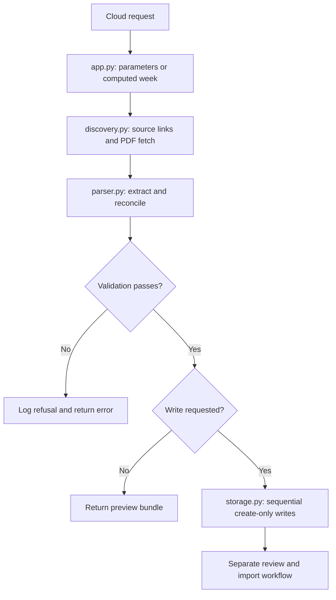

# Architecture and code walkthrough

Cloud Run IAM supplies authentication. The downstream Apps Script board is outside this package.

| Function | Responsibility |
| --- | --- |
| `scheduled_week` | Map local date and anchor to week 2–18 or skip |
| `discover_urls` | Match five source links from official page structures |
| `fetch_sources` | Enforce exact source categories; fetch bytes with size, PDF-signature, and final-host checks |
| `pdf_pages` | Extract PDF text; use layout mode for Circa selections |
| `parse_leading_standings` | Include complete rank groups until at least three entries are present |
| `parse_westgate_selections` | Match leader aliases and five team codes |
| `parse_circa_selections` | Match numbered picks and reconcile cross-row number/team/line mapping |
| `parse_westgate_card` | Produce 14 matchups and 28 team/line records |
| `build_bundle` | Assemble source evidence, entries, lines, validation counts and hash |
| `store_stage` | Write raw objects then bundle; record created/existing paths |

## Identity and evidence

Entry IDs use UUID5 over season, week, source group, and normalized alias. Source SHA-256 hashes cover raw bytes. Bundle SHA-256 covers canonical JSON **including its generation timestamp**. Identical source bytes processed at different timestamps generally produce different bundle hashes; this is not full run deduplication.

Alias normalization removes whitespace and normalizes a trailing numeric suffix. Duplicate normalized leaders are rejected. These identity rules are specialized and require reconsideration for customer domains.

`STAGED_NOT_LOADED` is also present in preview bundles: it is not proof that cloud persistence occurred. Inspect `writeRequested` and storage results separately.

## Agreement and display

The service stages records; it does not offer a generic consensus API. The new offline demo counts selection overlap separately per source group and generates an HTML table. It is not the production Apps Script implementation. Agreement counts entries, not independent people, probabilities, or recommendations.

For another industry, preserve separation of acquisition, validation, staging, and authorized delivery. Replace adapters and schemas, define business rules, test representative fixtures against a manual baseline, and only then enable approved external writes.
